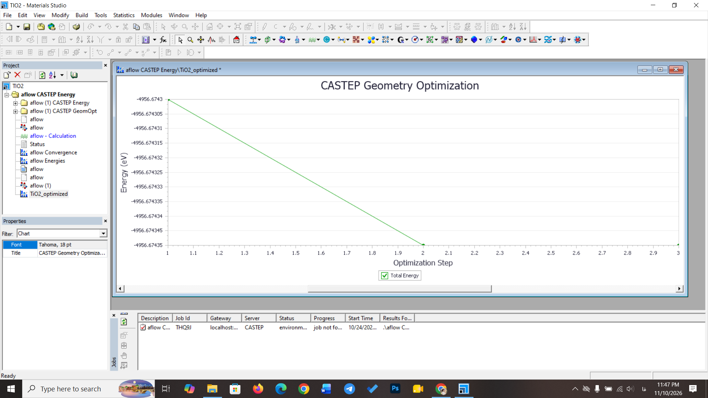

# Initial Anatase TiO2 Structure and Geometry Optimization

## 1. Electron Configuration of Titanium

The atomic number of titanium (Ti) is 22.

Its complete electron configuration is:

**Ti:**

1s² 2s² 2p⁶ 3s² 3p⁶ 4s² 3d²

The abbreviated electron configuration is:

**Ti: [Ar] 3d² 4s²**

Therefore, titanium has four valence electrons in its outermost electronic configuration (3d² 4s²).

### Oxidation State of Titanium in TiO2

In titanium dioxide (TiO2), titanium exhibits an oxidation state of +4.

The formation of the Ti4+ ion can be represented as:

Ti → Ti⁴⁺ + 4e⁻

During ion formation, the two 4s electrons are removed first, followed by the two 3d electrons.

The electron configuration of Ti4+ is:

**Ti4+: [Ar] 3d⁰**

The complete electron configuration becomes:

1s² 2s² 2p⁶ 3s² 3p⁶

Therefore, the Ti4+ ion has an empty 3d subshell.

### Oxidation State of Oxygen and TiO2 Stoichiometry

Oxygen commonly exhibits an oxidation state of −2 in metal oxides.

For an electrically neutral TiO2 formula unit, the sum of oxidation states must equal zero:

(+4) + 2(−2) = 0

Therefore, one titanium atom combines with two oxygen atoms to satisfy charge neutrality.

The resulting chemical formula is:

**TiO2**

The stoichiometric atomic ratio is:

**Ti : O = 1 : 2**

---

## 2. Construction of the Initial Anatase TiO2 Structure

First, The initial crystal structure of anatase TiO₂ was obtained from the AFLOW crystallographic database and imported into BIOVIA Materials Studio 2024.

The display style was changed to Ball and Stick to better visualize the atomic arrangement.

---

## 3. The Crystal Symmetry in Anatase TiO₂ 
Symmetry means that a structure remains unchanged after a specific operation, such as rotation, reflection or translation. In anatase TiO₂, titanium (Ti) and oxygen (O) atoms are arranged in a regular and repeating pattern. Crystal symmetry helps us understand how this atomic arrangement repeats and which operations leave the structure unchanged.

### 1️⃣ Periodicity: 3D (Crystal)
The unit cell shown in Materials Studio represents a small repeating part of the crystal. By repeating this unit cell along the three lattice vectors (a, b, and c), a larger crystal can be constructed.

### 2️⃣ Space Group: I4₁/amd
Anatase TiO₂ belongs to the tetragonal crystal system and for a conventional tetragonal unit cell:

a = b ≠ c

α = β = γ = 90°

### Space Group: I4₁/amd
A space group describes the complete symmetry of a crystal structure. It includes operations such as rotation, reflection, translation, and combinations of these operations. For anatase TiO₂, the space group is I4₁/amd.

The atomic composition was defined according to the stoichiometric ratio of titanium to oxygen (Ti : O = 1 : 2).

The initial unit cell contained:

- 2 Titanium (Ti) atoms
- 4 Oxygen (O) atoms

This composition corresponds to two TiO2 formula units and maintains the correct stoichiometric ratio.

---

## 3. Geometry Optimization Using CASTEP

After constructing the initial anatase TiO2 structure, geometry optimization was performed using the CASTEP module in Materials Studio.

The initial atomic positions do not necessarily represent the most stable configuration of the crystal. This is because atomic arrangements are influenced by:
1. electrostatic attraction between nuclei and electrons
2. nucleus–nucleus repulsion
3. electron–electron repulsion
4. chemical bonding interactions.

Therefore, geometry optimization was performed to minimize the total energy, reduce residual atomic forces, and obtain a more stable atomic arrangement.

### 3.1. CASTEP Geometry Optimization Parameters

The following computational settings were selected:

| Parameter | Selected Setting |
|:---|:---|
| Task | Geometry Optimization |
| Quality | Fine |
| Exchange-Correlation Functional | GGA-PBE |
| Spin Polarization | Non-polarized |
| Metal | Disabled |
| DFT+U | Disabled |
| Spin-Orbit Coupling | Disabled |
| Total Charge | 0 |

### 3.2. Rationale for the Selected Parameters

**Geometry Optimization:** Selected to relax the atomic positions and obtain a more energetically favorable structure.

**Quality: Fine:** Selected to provide relatively high numerical accuracy for the calculation.

**GGA-PBE:** Selected as a widely used exchange-correlation functional for investigating the structural properties of crystalline materials.

**Non-polarized:** Selected for the initial pristine TiO2 structure, which was treated as a non-magnetic reference system.

**Metal: Disabled:** The pristine anatase TiO2 structure is a semiconductor rather than a metal.

**DFT+U: Disabled:** The initial calculation was performed using conventional GGA-PBE to establish a reference structural model. The effect of DFT+U will be evaluated in subsequent Fe-doped models.

**Spin-Orbit Coupling: Disabled:** SOC was neglected in the initial structural calculation to simplify the computational model.

**Total Charge: 0:** Selected to represent an electrically neutral TiO2 unit cell.

### Geometry Optimization Results

**Figure 1. Total Energy during CASTEP Geometry Optimization of Pristine Anatase TiO₂.**

This graph shows the variation of the total energy over three optimization steps. The energy decreases slightly from the first to the second step and remains nearly constant in the third step.

| Optimization Step | Total Energy (eV) |
|:---:|---:|
| Step 1 | -4956.67430 |
| Step 2 | -4956.67435 |
| Step 3 | -4956.67435 |

**Step 1: Initial Structure**

CASTEP evaluated the initial atomic structure and calculated its total energy.

**Step 2: Atomic Position Adjustment**

CASTEP adjusted the atomic positions to reduce the total energy. As a result, the energy became slightly more negative.

**Step 3: Energy Stabilization**

The total energy remained nearly constant, indicating that the structure was approaching an energetically stable configuration.

